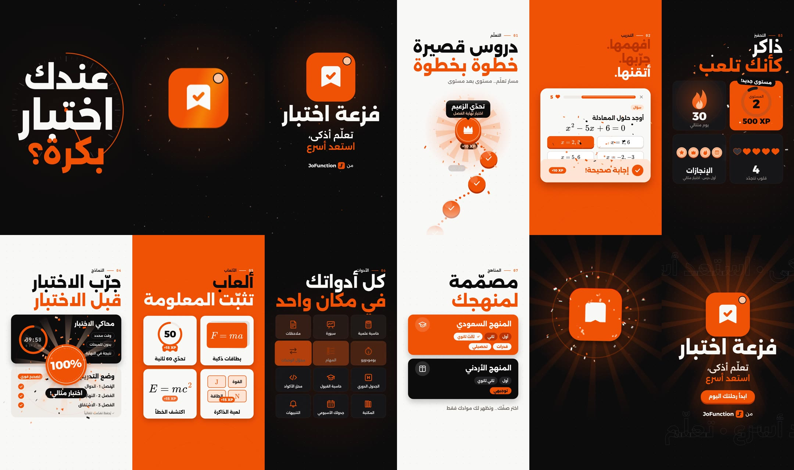

# Faz3at E5tebar — Reel (فزعة اختبار)

A 30-second vertical motion-design reel for **Faz3at E5tebar**, the gamified exam-prep platform by
JoFunction. It comes in two matching cuts, Arabic (RTL) and English. Both are built in the brand system: orange
`#FF5C00`, ink `#0B0B0C`, paper `#F9F8F6`, and peach `#FFC89F`, the notification dot from the app icon.
Both logos are redrawn as vectors from the supplied artwork. Every hit lands on an original 120 BPM score.

**Watch:**
- Arabic cut: [`out/faz3at-e5tebar-reel-ar.mp4`](out/faz3at-e5tebar-reel-ar.mp4)
- English cut: [`out/faz3at-e5tebar-reel-en.mp4`](out/faz3at-e5tebar-reel-en.mp4)

Both cuts are 1080×1920 (9:16, Instagram Reels), 60 fps, H.264 High + AAC 48 kHz, 30.0 s, and −14 LUFS.
No voiceover. They share every shot, timing, transition and the score. Only the copy changes, and the Arabic
cut mirrors the layout to read right to left. Key text stays inside the Reels safe area, so the caption and
buttons don't cover it.



## Beat map

30 s = 60 beats at 120 BPM. Every cut, hit and transition sits on this grid.

| Time | Shot | What moves |
|---|---|---|
| 0.0–2.5 s | Hook: *"Big exam tomorrow?"* / «عندك اختبار بكرة؟» | Three type slams land on the beat over a ticking exam clock. Then a glitch cut with RGB split to *"Don't panic. Help is here."* |
| 2.5–5.5 s | Logo build | The peach dot falls, squashes and bounces, then flies to the corner as the icon springs out of it. The bookmark unrolls, the checkmark draws on with the sonic logo, and the camera zooms through the bookmark. |
| 5.5–8.5 s | 01 Learn | A Duolingo-style learning path scrolls as lessons complete on 8th notes. The boss node unlocks with rays and confetti. |
| 8.5–11.5 s | 02 Practice | A lesson card: a KaTeX quadratic formula, a page swipe, then a question. Tap, check, *Correct! +10 XP*. *Learn it. Prove it. Own it.* lands with the story. |
| 11.5–14.5 s | 03 Gamified | The XP ring fills to *LEVEL UP*, the streak flame counts to 30, a heart breaks and refills, and badges bounce in under a glint. |
| 14.5–17.5 s | 04 Exams | The exam simulator countdown, training mode's instant feedback, and a *100%* stamp. |
| 17.5–20.5 s | 05 Games | A flashcard 3D flip, the 60-second quiz, memory match, and spot-the-error (E = mc³ → mc²). |
| 20.5–23.5 s | 06 Toolkit | Twelve study tools spring in as a diagonal wave, and a 16th-note highlight runs through them. |
| 23.5–26.0 s | 07 Curricula | Saudi (Qudurat · Tahsili) and Jordanian (Tawjihi) cards, with grade pills and an onboarding tap. |
| 26.0–30.0 s | End card | The icon rebuilds with a shockwave, light rays and confetti. Then the wordmark, tagline, CTA, and *by JoFunction*. |

Each shot uses a different transition: zoom-through, a two-layer iris out of the boss node, a vertical whip
pan, a diagonal wipe, a horizontal whip pan, blinds, a card fly-off and a liquid wave.
The picture uses true motion blur, with 4 sub-frames per frame at a 180° shutter. It also has camera shake,
radial chromatic aberration on the hits, glow, film grain and particles.

## Score

The soundtrack is synthesized from scratch in Web Audio (`js/audio.js`), with no samples. The hook sits on a
D-minor drone with a ticking clock and three cinematic *braams*. It resolves to D major when help arrives, and
the groove drops when the icon lands. The sonic logo is a rising D-major chime: it plays as the checkmark
draws and again on the end card. On top sits UI sound design: taps, coins, the correct-answer chime, the
level-up fanfare, card flips, a marker scribble and an error buzz. Each sound reads its time from the same
constants as the picture.

## Run it

```bash
npm install          # only needed for rendering (or use a global Playwright)
npm run serve        # then open http://localhost:8080 — player with sound, scrubber, space to play, AR/EN switch
npm run render                    # → out/faz3at-e5tebar-reel-ar.mp4 (4 workers, ~4–5 min)
npm run render -- --lang en       # → out/faz3at-e5tebar-reel-en.mp4
npm run stills -- out/stills 3.6 10.3 27 --lang en   # full-res stills (add --sheet sheet.jpg for a contact sheet)
```

The page has to be served over HTTP so the local fonts load. Rendering needs `ffmpeg` on the PATH.

## Structure

```
index.html          player shell (?capture → bare 1080×1920 canvas for the renderer, ?lang=en for English)
js/core.js          engine: easing, kinetic type, RTL mirroring, logos, icons, FX, transitions, motion blur
js/copy.js          every on-screen line, Arabic and English
js/scenes_a.js      hook + logo, learning path, lesson, gamification
js/scenes_b.js      exams, games, toolkit, curricula, end card, the edit
js/audio.js         the score and sound design
js/main.js          player + capture hooks
tools/render.cjs    offline render: score → loudness → frames → ffmpeg segments → MP4
fonts/              Alexandria, Space Grotesk, IBM Plex Mono (SIL OFL), KaTeX Main/Math (MIT)
```

Everything is a pure function of time, so the live player and the export are frame-identical.
