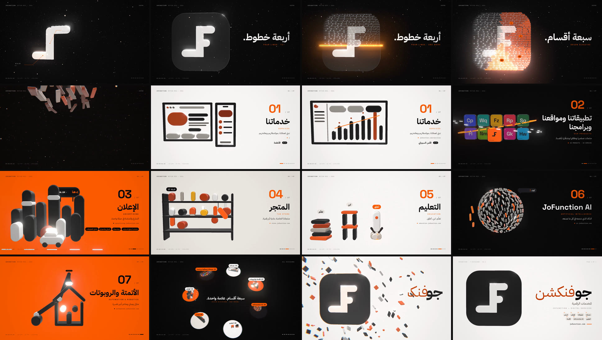

# JoFunction — 3D Motion Reel

A 30-second motion-design showreel for JoFunction, built from scratch: a new real-time
3D engine (three.js), a new score synthesized in Python, and nothing reused from the
earlier reel in this repo. The only input is the JoFunction division sheet (v2.1, Oct 2026).

**Watch:** [`out/jofunction-reel-3d.mp4`](out/jofunction-reel-3d.mp4) — 1920×1080, 60 fps, H.264 + AAC, 30.0 s



## The idea: four bars, seven divisions

The JoFunction monogram is four rounded bars. In this reel everything on screen is built
from those bars. The monogram rebuilds itself out of ~430 pill-shaped strips. On the drop,
it bursts into seven streams that land around a ring and become the seven divisions. Then
it recalls every pill back into the mark for the end card.

| Time | Beat | Shot | Technique |
|---|---|---|---|
| 0.0–3.0 s | bars 0–1 | Cold open → monogram | the four bars fly in on the beat (sonic logo D–A–C–F), tracked blueprint call-outs, the tile closes behind them |
| 3.0–4.6 s | bar 1–2 | "أربعة خطوط." | glint pass, then a glowing scanline converts the solid mark into strips of pills |
| 4.7–5.3 s | bar 2 | "سبعة أقسام." | the icon splits into seven wedges that light up on 32nd notes |
| 5.25–6.1 s | — | Burst | pills smear into streaks and the camera pushes through the explosion |
| 6–8 s | bar 3 | 01 Services | pills morph from browser + phone into a live dashboard; all 12 services flicker on 16ths |
| 8–10 s | bar 4 | 02 Products | the ten products as a periodic table, flip-in wave, counter-rotating orbit rings |
| 10–12 s | bar 5 | 03 Advertising | a skyline rises out of the floor, a billboard flips up with a live LED ticker, a car with a roof screen drives through |
| 12–14 s | bar 6 | 04 Store | 18 products drop onto shelves with bounce and squash, and a cart counter ticks up |
| 14–16 s | bar 7 | 05 Education | Learn · Build · Launch: books stack, a frame snaps together, a rocket launches |
| 16–18 s | bar 8 | 06 JoFunction AI | a Fibonacci sphere of pills, light bands sweep across it, and a typed reply appears |
| 18–20 s | bar 9 | 07 Automation & Robotics | an IK robot arm places a chip on a house and the smart home switches on |
| 20–24 s | bars 10–11 | Overview → recall | crane up over the ring of seven worlds, then every pill flies home into the mark |
| 24–30 s | bars 12–14 | End card | impact, spring settle, bilingual wordmark, the seven divisions, jofunction.com |

Each division gets one bar of music. Between divisions the camera does a whip pan with
screen-space motion blur, and the background color script shifts on the downbeat.

## How it's made

- `src/pills.js` — one `InstancedMesh` of bevelled stadiums. Length is stretched in the
  vertex shader so the caps never distort. Every pill has a keyframe track whose targets
  can be functions of time, so pills can fly between moving formations. Fast pills stretch
  along their velocity (smear frames). Hidden and off-screen pills are culled before upload.
- `src/stations.js` — the seven dioramas, written in local space.
- `src/reel.js` — choreography, camera (shots plus timed transitions), the color script, and the monogram.
- `src/overlay.js` — all typography: HUD, kinetic Arabic/Latin type, tracked call-outs, and the end card.
- `src/stage.js` — renderer, lights, bloom, and one final pass that does sRGB output, FXAA,
  whip blur, aberration, overlay compositing, vignette, flashes and grain.
- `audio/score.py` — the score: 120 BPM in D minor, resolving to D major on the end card.
  Kick, clap, hats, bass, supersaw pads and stabs, FM bells, and every effect are synthesized
  with numpy/scipy and placed on the picture's clock. `tools/master.mjs` masters it to −14 LUFS
  with a −1 dBTP ceiling.
- `tools/render.mjs` — renders the reel in parallel headless Chromium (SwiftShader WebGL)
  workers that stream raw frames into ffmpeg, then muxes the score.

## Run it

```bash
npm install
npm run score && node tools/master.mjs       # out/score.wav
npm run render                                # out/jofunction-reel-3d.mp4 (~25 min on 4 CPU cores)
node tools/render.mjs --fps 30 --scale 0.5    # quick half-res preview
node tools/stills.mjs out/stills 3.5 9 16.8 --sheet sheet.jpg
```

To scrub and play it live with sound, serve the folder (for example with `npx http-server .`)
and open `index.html`.

Fonts are IBM Plex Sans Arabic, Space Grotesk and IBM Plex Mono (SIL OFL), from `@fontsource`.
